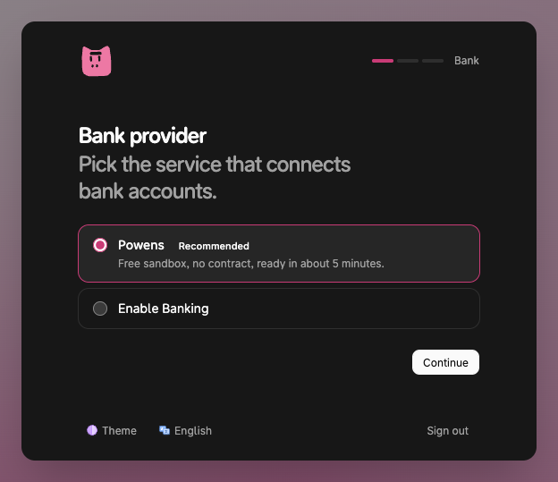
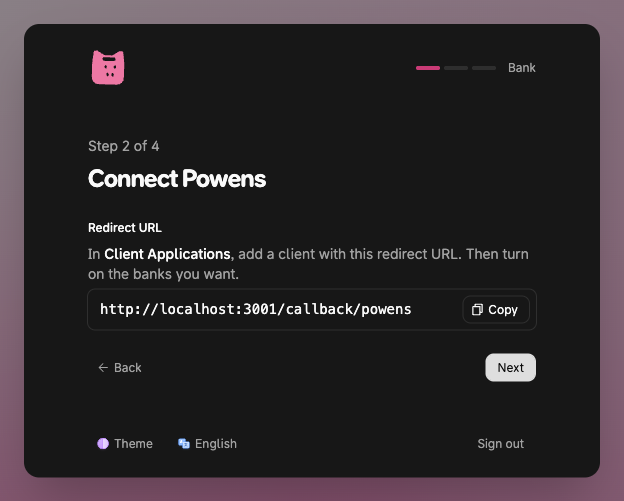
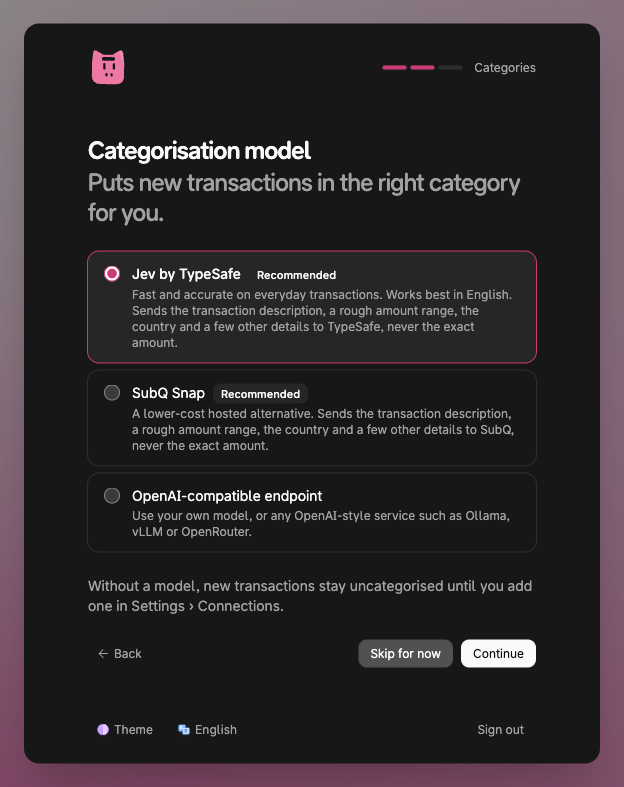
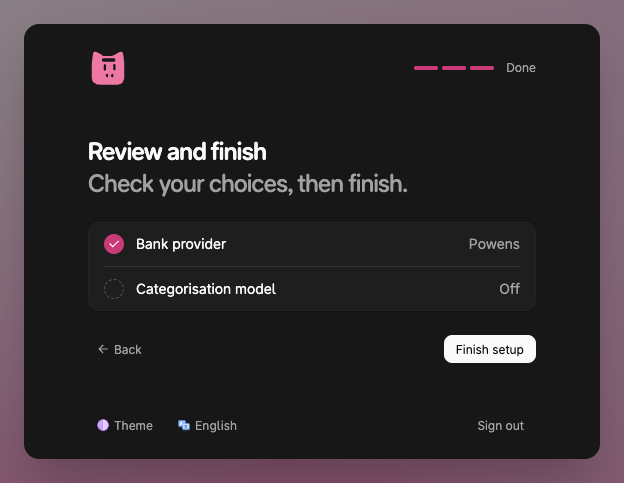
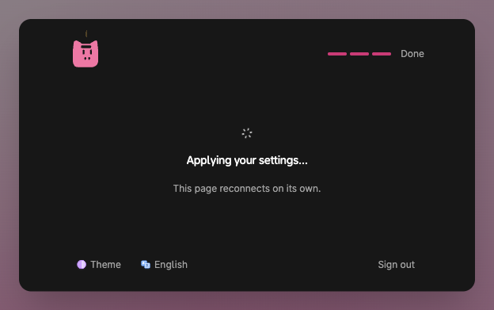
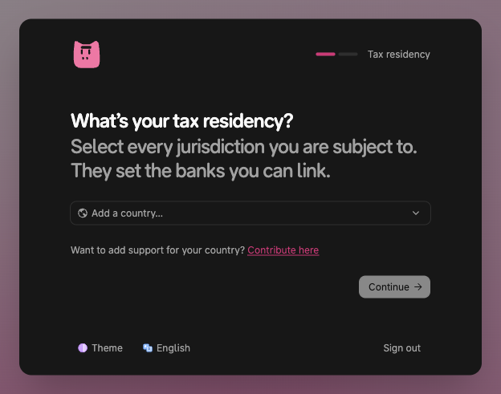

In this tutorial you finish the setup screen, connect a test bank, and see your first imported transactions. You use a free Powens sandbox, so no real bank account is involved.

Freenary does not talk to banks itself. It uses a **bank provider**, a service that connects to banks for it. The setup screen offers two: Powens and Enable Banking. A real instance cannot finish setup without one. This tutorial uses Powens because the app marks it **Recommended** and describes it as **Free sandbox, no contract, ready in about 5 minutes.**

## Before you start

- Freenary runs and you are signed in as the operator, on the setup screen. If not, follow [Get it running](get-it-running.md) or [Self-host on a server](self-host-on-a-server.md) first.
- You know your instance's address: `http://localhost:3001` after [Get it running](get-it-running.md), or your `https://` domain.
- The `server` container can reach the internet: it calls the Powens API.

## 1. Create a Powens sandbox

1. Open [the Powens console registration page](https://console.powens.com/auth/register) and create a free account.
2. In the console, create a **domain**. A domain is your own space at Powens, with a name such as `acme-sandbox`. Write the name down.

> **TODO (unverified):** the exact menus of the Powens console for creating an account and a domain. Freenary's code only links the registration page.

## 2. Choose Powens on the setup screen

1. On the **Bank provider** page, select **Powens**.

   

2. Select **Continue**.

The page now shows **Connect Powens** and **Step 1 of 4**.

## 3. Enter the Powens details

1. **Step 1 of 4, Powens domain.** Enter the domain name from part 1, for example `acme-sandbox`. Type the name only, without `https://`. Select **Next**.
2. **Step 2 of 4, Redirect URL.** The page shows your instance's address followed by `/callback/powens`, for example `http://localhost:3001/callback/powens`. Select **Copy**.

   In the Powens console, under **Client Applications**, add a client and paste this URL as its redirect URL. Then turn on the banks you want to use. Powens sends you back to this URL after you connect a bank. Select **Next** in Freenary.

   

   > **TODO (unverified):** where **Client Applications** is in the Powens console, and how to turn on banks, including the test bank **Connecteur de test**.

3. **Step 3 of 4, Client ID.** Copy the client ID of the client you just added, and paste it. Select **Next**.
4. **Step 4 of 4, Client secret.** Copy the client secret of the same client, and paste it.
5. Select **Save and continue**.

Freenary tests the details with Powens before it saves them. If the test passes, the setup screen moves to **Categories**. If you see **Powens refused these credentials. Check them and try again.**, check that the client ID and the client secret come from the same client. [Configure Powens](../how-to/configure-powens.md#if-something-goes-wrong) lists the other messages.

## 4. Skip categorisation for now

The **Categories** step connects a model that sorts new transactions into categories. You can add one later.

1. Read the note next to the button: **Without a model, new transactions stay uncategorised until you add one in Settings › Connections.**
2. Select **Skip for now**.

   

The setup screen moves on to the **Done** step. To set up categorisation later, see [Enable transaction categorisation](../how-to/enable-transaction-categorisation.md).

## 5. Finish the setup

1. On **Review and finish**, check your choices.
2. Select **Finish setup**.

   

The page shows **Applying your settings…** and **This page reconnects on its own.** The server restarts to load the new settings, then the app shows **The instance is set up.** and moves on.

## 6. Connect the test bank

Every member, including you, now sets up their own account.

1. **What’s your tax residency?** Add the country that the test bank belongs to, then select **Continue**. The countries you pick decide which banks you can link.

   

   > **TODO (unverified):** which country lists **Connecteur de test** in a Powens sandbox. It is expected to be France.

2. **Connect your bank.** Search for `Connecteur de test` in **Search banks…**, then select **Connect** next to it.
3. The browser opens the Powens page for that bank. Sign in to the test bank with the password `1234`, as the setup screen said on **Step 4 of 4**.

   > **TODO (unverified):** the Powens sign-in page for the test bank (fields and buttons).

4. Powens sends you back to Freenary. A notice says **Connected 1 account** (or **Connected 2 accounts**, and so on), and you return to **Connect your bank**.
5. Select **Finish (1)**. The number counts your connected banks.

The app shows **You’re all set!**.

## 7. Check that it works

1. The home page lists the test bank's accounts.
2. Open an account. Its transactions appear. Right after the connection, the account can read **No transactions on this account yet. They appear after the bank's next sync.** Wait a moment and reload.

> **TODO (unverified):** the whole of part 6 and part 7 was not run against a real Powens sandbox. The texts come from the app's English message file.

## You're done

Your instance has a bank provider, and your first bank account is connected.

Next:

- [Enable transaction categorisation](../how-to/enable-transaction-categorisation.md) so new transactions get a category.
- [Configure email](../how-to/configure-email.md) so members can confirm their address and reset their password.
- [Configure Powens](../how-to/configure-powens.md) to move from the sandbox to production credentials, or to set the details in `.env`.

## If something goes wrong

- **The Bank step shows Configured through environment variables instead of the provider list.** The server's `.env` already sets the bank provider and its credentials, so there is nothing to enter here. Select **Continue**, or remove those lines from `.env` and run `docker compose up -d --wait` to enter them in the app.
- **Saving shows Your server's environment sets this provider.** `.env` sets `BANKING_PROVIDER` to a different provider than the one you chose. Remove that line from `.env`, run `docker compose up -d --wait`, and try again.
- **Unable to reach Powens. Check the address and your network, then try again.** The `server` container cannot reach `https://<domain>.biapi.pro`. Check the domain name and the server's internet access.
- **The server did not restart** after **Finish setup**. Run `docker compose ps` and `docker compose logs server`, then `docker compose up -d --wait`, and select **Try again**.
- **Bank connection cancelled. Nothing was linked.** You left the Powens page before the end. Select **Connect** again.
